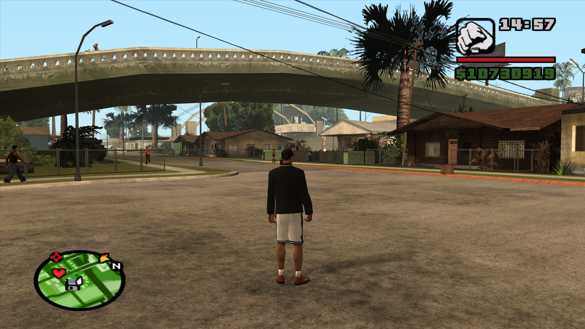
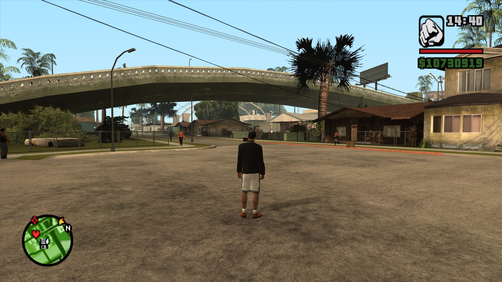
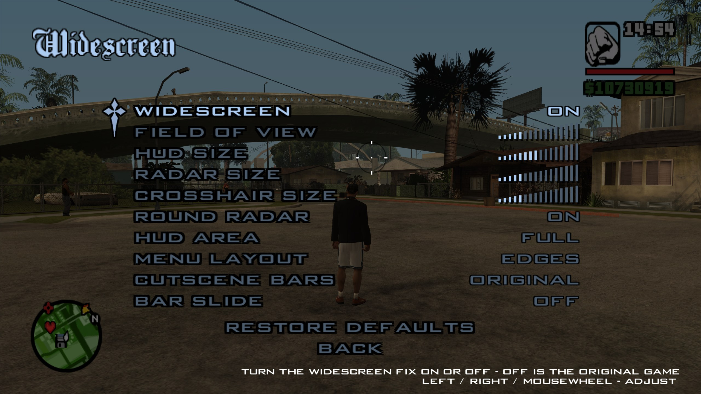
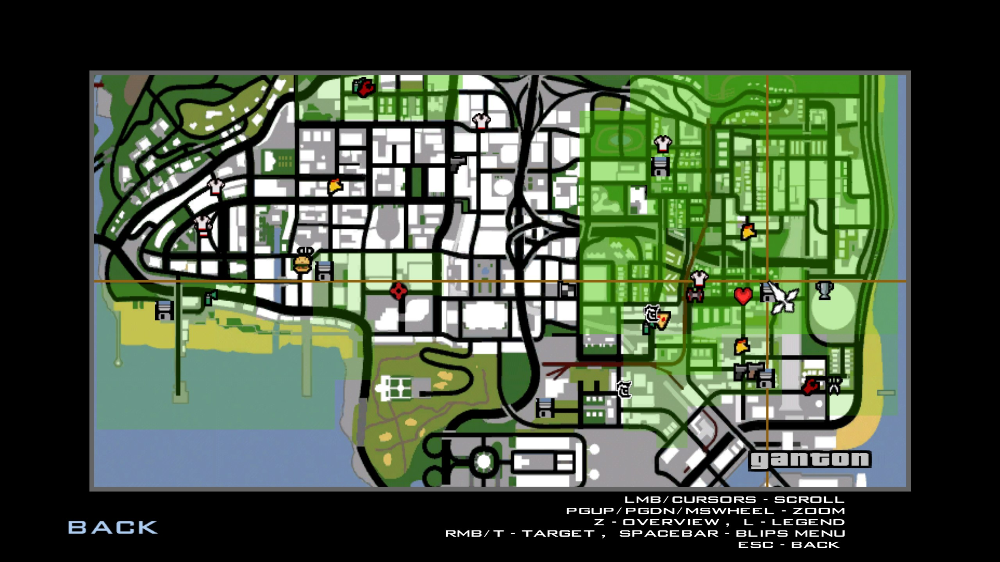

# neufox's Widescreen

English | [Português (Brasil)](README.pt-BR.md)

[](https://www.sa-mp.mp/)
[](https://www.open.mp/)
[](#install)
[](LICENSE)
[](https://github.com/itsneufox/neufox-s-Widescreen/actions/workflows/build.yml)

**A properly made widescreen fix for GTA San Andreas.** Any screen shape, a HUD that keeps its
shape, a round radar, menus and a map that fit, and nothing broken in SA-MP: textdraws, chat and
everything a server draws stay exactly where the server put them.

Everything can be changed in game, with the game still visible behind the menu while you do.

<table>
  <tr>
    <td></td>
    <td></td>
  </tr>
  <tr>
    <td align="center">Original</td>
    <td align="center">neufox's Widescreen</td>
  </tr>
</table>

## Why?

GTA San Andreas was made for 4:3. On a wide screen it stretches the whole HUD and every menu
sideways, and crops the top and bottom of the 3D view instead of showing more at the sides.

For years the answer was ThirteenAG's Widescreen Fix. Its newer versions move SA-MP textdraws
to the right, breaking the interfaces servers built with them
([WidescreenFixesPack#2269](https://github.com/ThirteenAG/WidescreenFixesPack/issues/2269)).
The reply there:

> SAMP is not supported and was never supported.

It has also grown into an unnecessary general overhaul of the game: menus, graphics, camera, frame limiter
and more, all bundled with the widescreen part.

neufox's Widescreen is just that, made to work with SA-MP and open.mp from the start. It corrects only
what the game itself draws for 4:3 (its HUD, menus, map, loading screens and cutscene bars) and
leaves everything a server draws exactly as it was. Nothing else about your game changes.

## Features

**The view**

- **Hor+**: wide screens show more at the sides instead of cutting off the top and bottom.
- **Any aspect ratio**: 16:9, 16:10, 21:9, 32:9, taken from your window.
- **Field of view**: a slider from 0.5x to 2x. Cutscenes keep their own framing.
- **Aiming lines up**: the crosshair, aim direction, culling and sky all follow the wider view.
- **Water at the edges**: no more water popping in and out at the sides.
- **Round coronas**: lights and the sun stay round.

**The HUD**

- **Original proportions**: every part keeps its shape and its distance from its edge.
- **Round radar**: the original is a slightly wide oval, even at 4:3. This one is a circle.
- **Square weapon icon**: the original draws it taller than wide; here it keeps the shape of its picture.
- **Sizes**: the whole HUD, the radar and the crosshair, each with its own slider.
- **HUD area**: keep the HUD inside 4:3, 16:10, 16:9 or 21:9 on ultrawide screens.
- **Every part adjustable**: size and position of the radar, money, wanted level, timers, subtitles and more.

**Menus and screens**

- **Menus**: drawn in 4:3 proportions, with titles and pictures at the screen edges and the mouse lined up.
- **Wide map**: the pause-menu map fills the screen and shows more of San Andreas.
- **Loading screens and backgrounds**: keep their own shape, so widescreen artwork mods look right.
- **Intro videos**: play without stretching, or skip them.
- **Cutscene bars**: original, off, or pillarboxed to the exact original framing, with an optional slide.
- **Text outline**: menu and HUD text gets a smooth, round outline instead of the shadow and blocky edge. Optional.

**SA-MP and open.mp**

- **Textdraws untouched up to 16:9**: there, only the game's own HUD and menus are corrected.
- **Textdraw scaling on wider screens**: textdraws keep their 16:9 shape, panel by panel, or stay in a 16:9 box. Clicks follow them, and it can be turned off.
- **`/hudscalefix`**: detected and handled, so it can stay on or off.
- **open.mp's menu page**: works alongside it.
- **Other widescreen fixes**: if one is installed, the mod tells you which file to remove instead of fixing everything twice.

<table>
  <tr>
    <td></td>
    <td></td>
  </tr>
  <tr>
    <td align="center">Widescreen Settings, with the game live behind it</td>
    <td align="center">The map, using the whole screen</td>
  </tr>
</table>

## Install

1. Download `neufoxWidescreen-vX.X.X.zip` from the [releases page](../../releases).
2. Copy `neufoxWidescreen.asi` and `neufoxWidescreen.ini` into your **GTA San Andreas** folder
   (or `scripts\`, or a folder inside `modloader\`).
3. Remove any other widescreen fix.

Requires GTA San Andreas **1.0 US or EU** and an ASI loader, such as Silent's ASI Loader or
modloader. If the `.ini` is missing, it is created on first start.

## Settings

**In game**: *Options > Display Setup > Advanced > Widescreen Settings*, a list of categories
like the game's Options page:

| Category | Settings |
| --- | --- |
| General | Widescreen on/off, aspect ratio, text outline, textdraws, live preview, skip intro |
| Camera | Wider view (Hor+), field of view, round coronas, water fix |
| HUD | HUD size, width and height, HUD area, radar size, round radar, crosshair size, square weapon icon |
| HUD Parts | Size and position of each part of the HUD |
| Menus | Menu layout and area, wide map, backgrounds, loading screens, intro videos |
| Cutscenes | Cutscene bars, bar size, bar slide |

Every page has its own Restore Defaults. On the Camera, HUD and HUD Parts pages the game keeps
running behind the menu, so you see each change as you make it.

**In `neufoxWidescreen.ini`**: everything above, and more. Every setting has a comment. Save the file and
the change applies while the game runs.

## Troubleshooting

Set `Log = 1` under `[Debug]` and start the game. `neufoxWidescreen.log` lists what was patched
and what was skipped, and why. Please attach it when you [report a problem](../../issues).

## Building

Needs a MinGW-w64 i686 toolchain (`g++-mingw-w64-i686` on Debian/Ubuntu).

```bash
make                      # build/neufoxWidescreen.asi
make dist VERSION=v1.0.0  # build/neufoxWidescreen.zip
```

Releases are built by GitHub Actions: *[Actions > Release](../../actions/workflows/release.yml) >
Run workflow*, enter the version (e.g. `1.0.0`) and the release type. Versions are
`MAJOR.MINOR.PATCH.BUILD`, with the commit count as the build number:

| Release type | Tag |
| --- | --- |
| stable | `v1.0.0.123` |
| release-candidate | `v1.0.0.123-rc` |
| beta | `v1.0.0.123-beta` |

The version is built into the `.asi` and written at the top of the log.

<details>
<summary><b>How it works</b></summary>

The game lays out all 2D on a 640x448 canvas and stretches it over the window. Instead of
patching the hundreds of places that compute that stretch, the mod opens a *scope* around each
HUD and menu draw function. Everything drawn inside goes through one transform (a horizontal
correction around an anchor: an edge, the centre or the aim point), applied where RenderWare
receives the vertices. Anything drawn outside a scope (SA-MP, CLEO, other mods) is left alone.

- `src/scope.cpp`, `src/thunks.S`: detours that open and close a scope, whatever the calling convention.
- `src/im2d.cpp`: transforms sprites, rectangles and radar polygons.
- `src/font.cpp`: transforms text when it is queued.
- `src/hud.cpp`, `src/frontend.cpp`: the HUD parts, menus, loading screens and the wide map.
- `src/camera.cpp`: aspect ratio, Hor+, frustum, aim, sprites and sky.
- `src/menu.cpp`: the in-game Widescreen Settings page and its live preview.
- `src/water.cpp`, `src/cutscene.cpp`, `src/video.cpp`: water culling, cutscene bars, intro videos.
- `src/region.cpp`: 1.0 EU support (addresses are written for 1.0 US and translated).

Every patch checks the original bytes first. If another mod or game version changed them,
that patch is skipped and logged.

</details>

## Credits

- **Edgyaf** and **EvilShadeZ**: testing and ideas.
- **iAmir** and **beczy**: help with 1.0 EU support.

## License

MIT, see [LICENSE](LICENSE).
