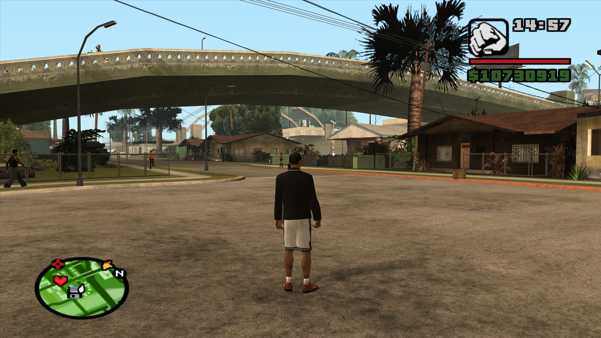
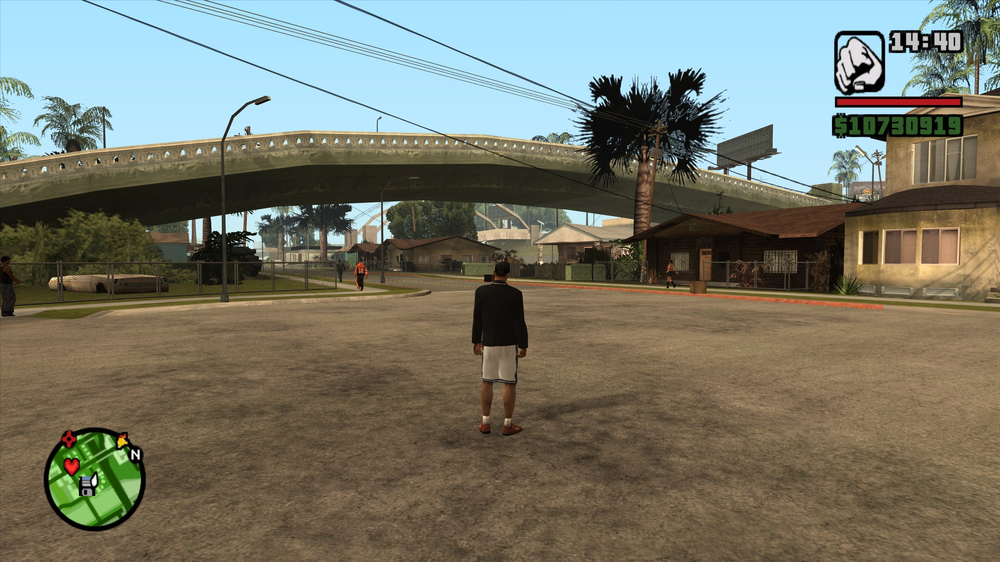
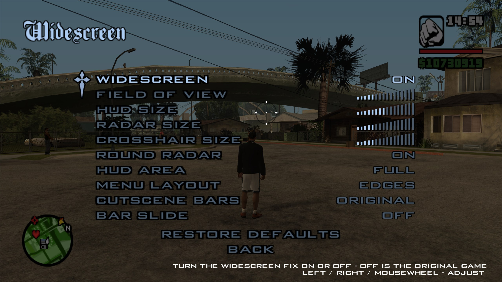
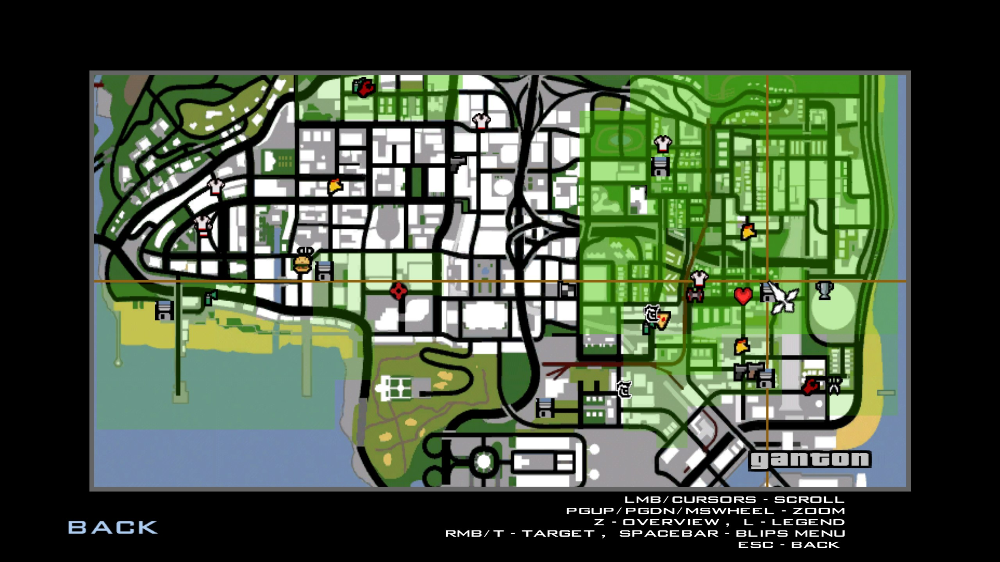

# neufox's Widescreen

[English](README.md) | Português (Brasil)

[](https://www.sa-mp.mp/)
[](https://www.open.mp/)
[](#instalação)
[](LICENSE)
[](https://github.com/itsneufox/neufox-s-Widescreen/actions/workflows/build.yml)

**Um widescreen fix bem feito para GTA San Andreas.** Qualquer formato de tela, um HUD que mantém
o formato, radar redondo, menus e mapa que cabem na tela, e nada quebrado no SA-MP: textdraws, chat
e tudo o que o servidor desenha ficam exatamente onde o servidor colocou.

Dá para mudar tudo dentro do jogo, com o jogo ainda visível atrás do menu enquanto você ajusta.

<table>
  <tr>
    <td></td>
    <td></td>
  </tr>
  <tr>
    <td align="center">Original</td>
    <td align="center">neufox's Widescreen</td>
  </tr>
</table>

## Por quê?

O GTA San Andreas foi feito para 4:3. Numa tela larga ele estica o HUD e todos os menus para os
lados, e corta o topo e a base da imagem 3D em vez de mostrar mais nas laterais.

Durante anos a resposta foi o Widescreen Fix do ThirteenAG. As versões mais novas dele empurram os
textdraws do SA-MP para a direita, quebrando as interfaces que os servidores fizeram com eles
([WidescreenFixesPack#2269](https://github.com/ThirteenAG/WidescreenFixesPack/issues/2269)).
A resposta lá foi:

> SAMP is not supported and was never supported.

Ele também virou uma reforma geral do jogo: menus, gráficos, câmera, limitador de FPS e mais,
tudo junto com a parte de widescreen.

O neufox's Widescreen é só isso, feito para funcionar com SA-MP e open.mp desde o começo. Ele
corrige apenas o que o próprio jogo desenha para 4:3 (HUD, menus, mapa, telas de carregamento e
barras das cutscenes) e deixa tudo o que o servidor desenha exatamente como estava. Nada mais no
seu jogo muda.

## Recursos

**A imagem**

- **Hor+**: telas largas mostram mais nas laterais em vez de cortar o topo e a base.
- **Qualquer proporção**: 16:9, 16:10, 21:9, 32:9, detectada pela janela.
- **Campo de visão**: um controle deslizante de 0.5x a 2x. As cutscenes mantêm o próprio enquadramento.
- **Mira alinhada**: a mira, a direção do tiro, o culling e o céu acompanham a imagem mais larga.
- **Água nas bordas**: a água não some e reaparece mais nas laterais.
- **Coronas redondas**: luzes e o sol continuam redondos.

**O HUD**

- **Proporções originais**: cada parte mantém o formato e a distância da borda.
- **Radar redondo**: o original é uma oval levemente larga, até em 4:3. Este é um círculo.
- **Ícone da arma quadrado**: o original desenha mais alto que largo; aqui ele mantém o formato da imagem.
- **Tamanhos**: o HUD inteiro, o radar e a mira, cada um com seu controle deslizante.
- **Área do HUD**: mantém o HUD dentro de 4:3, 16:10, 16:9 ou 21:9 em monitores ultrawide.
- **Cada parte ajustável**: tamanho e posição do radar, dinheiro, nível de procurado, timers, legendas e mais.

**Menus e telas**

- **Menus**: desenhados em proporção 4:3, com títulos e imagens nas bordas da tela e o mouse alinhado.
- **Mapa largo**: o mapa do menu de pausa ocupa a tela toda e mostra mais de San Andreas.
- **Telas de carregamento e fundos**: mantêm o próprio formato, então mods com artes widescreen ficam certos.
- **Vídeos de abertura**: tocam sem esticar, ou podem ser pulados.
- **Barras das cutscenes**: originais, desligadas, ou com barras laterais no enquadramento original exato, com deslize opcional.

**SA-MP e open.mp**

- **Textdraws intactos**: só o HUD e os menus do próprio jogo são corrigidos.
- **`/hudscalefix`**: detectado e tratado, pode ficar ligado ou desligado.
- **Página de menu do open.mp**: funciona junto.
- **Outros widescreen fixes**: se houver um instalado, o mod diz qual arquivo remover em vez de corrigir tudo duas vezes.

<table>
  <tr>
    <td></td>
    <td></td>
  </tr>
  <tr>
    <td align="center">Widescreen Settings, com o jogo ao vivo atrás</td>
    <td align="center">O mapa, usando a tela toda</td>
  </tr>
</table>

## Instalação

1. Baixe o `neufoxWidescreen-vX.X.X.zip` na [página de releases](../../releases).
2. Copie `neufoxWidescreen.asi` e `neufoxWidescreen.ini` para a pasta do **GTA San Andreas**
   (ou para `scripts\`, ou para uma pasta dentro de `modloader\`).
3. Remova qualquer outro widescreen fix.

Você precisa do GTA San Andreas **1.0 US ou 1.0 EU** e de um ASI loader. SA-MP, open.mp, CLEO e
modloader já vêm com um. Copiou só o `.asi`? O `.ini` é criado na primeira vez que o jogo abre.

## Configurações

**No jogo**: *Options > Display Setup > Advanced > Widescreen Settings*, uma lista de categorias
como a página Options do jogo:

| Categoria | Opções |
| --- | --- |
| General | Widescreen liga/desliga, proporção, prévia ao vivo, pular a abertura |
| Camera | Imagem mais larga (Hor+), campo de visão, coronas redondas, correção da água |
| HUD | Tamanho, largura e altura do HUD, área do HUD, tamanho do radar, radar redondo, tamanho da mira, ícone da arma quadrado |
| HUD Parts | Tamanho e posição de cada parte do HUD |
| Menus | Layout e área dos menus, mapa largo, fundos, telas de carregamento, vídeos de abertura |
| Cutscenes | Barras das cutscenes, tamanho, deslize |

Cada página tem o próprio Restore Defaults. Nas páginas Camera, HUD e HUD Parts o jogo continua
rodando atrás do menu, então você vê cada mudança na hora.

**No `neufoxWidescreen.ini`**: tudo acima, e mais. Cada opção tem um comentário. Salve o
arquivo e a mudança vale com o jogo aberto.

## Problemas

Coloque `Log = 1` em `[Debug]` e abra o jogo. O `neufoxWidescreen.log` lista o que foi aplicado,
o que foi pulado e por quê. Anexe ele quando [reportar um problema](../../issues).

## Compilando

Precisa do toolchain MinGW-w64 i686 (`g++-mingw-w64-i686` no Debian/Ubuntu).

```bash
make                      # build/neufoxWidescreen.asi
make dist VERSION=v1.0.0  # build/neufoxWidescreen.zip
```

As releases são feitas pelo GitHub Actions: *[Actions > Release](../../actions/workflows/release.yml) >
Run workflow*, informe a versão (por exemplo `1.0.0`) e o tipo de release. As versões seguem
`MAJOR.MINOR.PATCH.BUILD`, com o número de commits como número do build:

| Tipo de release | Tag |
| --- | --- |
| stable | `v1.0.0.123` |
| release-candidate | `v1.0.0.123-rc` |
| beta | `v1.0.0.123-beta` |

A versão fica gravada no `.asi` e aparece no topo do log.

<details>
<summary><b>Como funciona</b></summary>

O jogo monta todo o 2D numa tela de 640x448 e estica isso por cima da janela. Em vez de mexer nas
centenas de lugares que calculam esse esticamento, o mod abre um *escopo* em volta de cada função
que desenha o HUD e os menus. Tudo o que é desenhado ali dentro passa por uma transformação (uma
correção horizontal em volta de uma âncora: uma borda, o centro ou o ponto da mira), aplicada
onde o RenderWare recebe os vértices. O que é desenhado fora de um escopo (SA-MP, CLEO, outros
mods) não é tocado.

- `src/scope.cpp`, `src/thunks.S`: detours que abrem e fecham um escopo, qualquer que seja a convenção de chamada.
- `src/im2d.cpp`: transforma sprites, retângulos e os polígonos do radar.
- `src/font.cpp`: transforma o texto quando ele entra na fila.
- `src/hud.cpp`, `src/frontend.cpp`: as partes do HUD, menus, telas de carregamento e o mapa largo.
- `src/camera.cpp`: proporção, Hor+, frustum, mira, sprites e céu.
- `src/menu.cpp`: a página Widescreen Settings no jogo e a prévia ao vivo.
- `src/water.cpp`, `src/cutscene.cpp`, `src/video.cpp`: culling da água, barras das cutscenes, vídeos de abertura.
- `src/region.cpp`: suporte ao 1.0 EU (os endereços são escritos para o 1.0 US e traduzidos).

Cada patch confere os bytes originais primeiro. Se outro mod ou outra versão do jogo mudou esses
bytes, aquele patch é pulado e registrado no log.

</details>

## Créditos

- **Edgyaf** e **EvilShadeZ**: testes e ideias.
- **iAmir**: ajuda com o suporte ao 1.0 EU.

## Licença

MIT, veja [LICENSE](LICENSE).
